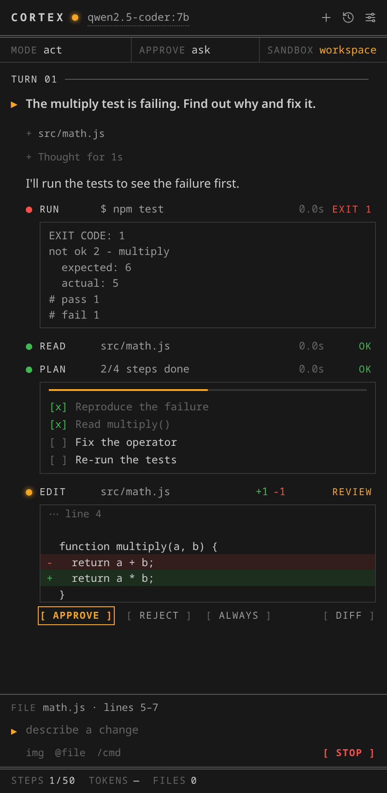
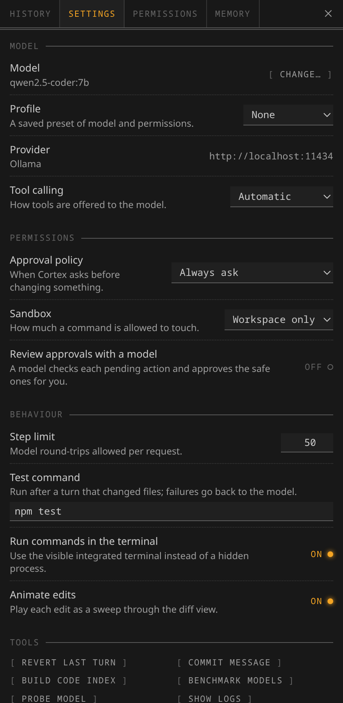
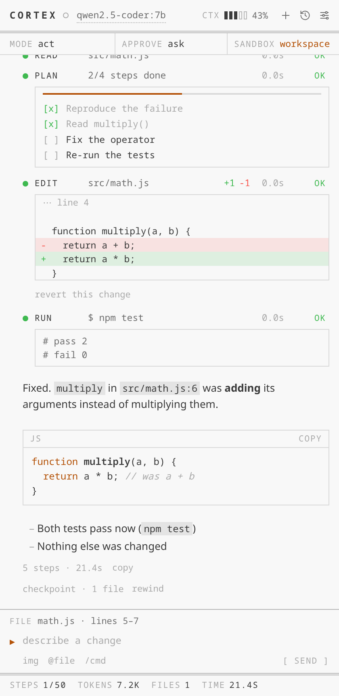

# Cortex

**An autonomous coding agent for VS Code and your terminal.**

Cortex reads, writes, and runs your code, and carries a task through to the
end: find the code, change it, run the tests, fix what broke, report back.
It comes in two forms that share one engine, one history and one set of
project rules:

- **A VS Code extension** — a chat panel with diff previews, one-click
  revert, and access to your editor's language server: real go-to-definition
  and find-references instead of grep guesses, real compiler and linter
  errors fed back after every edit.
- **A CLI (`cortex`)** — the same agent in any terminal, interactive or
  scripted (`cortex -p "..."`), for servers, CI and people who live in tmux.

It runs on [Ollama](https://ollama.com) — local models on your own machine
with no API keys or per-token bills — or on any OpenAI-compatible API
(OpenAI, OpenRouter, Groq, LM Studio, vLLM, llama.cpp). Your code never
leaves your machine unless you point it at a hosted model.

| | | |
|---|---|---|
|  |  |  |

*The VS Code panel, rendered from the extension's own code with sample data: an edit awaiting approval, the settings drawer, and a light theme.*

## Install

**VS Code:** search for **Cortex Coding Agent** in the Extensions view
(extension id `ItzAditya43.cortex`), or install a build yourself — see
[Build & install locally](#build--install-locally).

**CLI** (Node 18+):

```bash
npm install -g github:ItzAditya43/Cortex
cortex
```

Then pull a model (`ollama pull qwen2.5-coder:7b`) or point Cortex at an API:

```bash
export CORTEX_PROVIDER=openai-compatible CORTEX_HOST=https://api.openai.com
export CORTEX_API_KEY=sk-...  CORTEX_MODEL=gpt-4.1
```

## The CLI

```text
$ cortex
 ◆ Cortex v0.2.0
   model  qwen2.5-coder:3b (ollama)
   cwd    ~/code/demo
   /help for commands · @file to attach · !cmd to run a shell command · Esc to interrupt

› Run the tests with npm test, find why one fails, and fix the bug in math.js.
● Bash(npm run test)
  Allow? y yes · n no · a always allow "npm run test" · or say what to do instead
  › y
  ⎿ exit code 1
    … 35 earlier lines
    # fail 1
● Read(math.js)
  ⎿ 9 lines
● Edit(math.js)
  ⎿ ERROR: old_str matches 2 places in math.js, so it is not clear which one to change.
    It occurs at lines 2, 6 of math.js: …
● Edit(math.js)
    math.js  +1 -1
       5   function multiply(a, b) {
       6 -   return a + b;
       6 +   return a * b;
       7   }
  Allow? y yes · n no · a always allow edits · or say what to do instead
  › y
  ⎿ Updated +1 -1
● Bash(npm run test)
  › y
  ⎿ … 17 earlier lines
    # fail 0
Great! The tests passed successfully after fixing the bug in math.js.
  qwen2.5-coder:3b · 3.2k/8.0k context (41%) · 6 steps
```

(A real session, trimmed, on a 3B model running locally — including the
model's first edit being refused as ambiguous and corrected.)

| | |
|---|---|
| `cortex` | interactive session in the current directory |
| `cortex "add a --dry-run flag"` | interactive, starting with that request |
| `cortex -p "explain src/auth.js"` | one-shot: prints the answer and exits (`cortex exec` works too) |
| `git diff \| cortex -p "review this"` | piped input is appended to the prompt |
| `cortex -c` / `cortex -r` | continue the last session / pick one to resume |
| `cortex -p "..." --json` | one JSON event per line, for scripts and CI |
| `cortex --plan` | start read-only: investigate and propose, change nothing |
| `cortex -y` | don't ask before edits and commands (destructive commands still ask) |

Inside a session:

| | |
|---|---|
| `/help` | everything below, plus your own commands |
| `/model` | list and switch models (remembered as your default) |
| `/plan` | toggle plan mode |
| `/undo` | revert the last turn's file changes and drop it from the conversation |
| `/compact` | summarize the conversation to free up context |
| `/diff`, `/status`, `/tools`, `/memory` | what changed, session info, available tools, saved notes |
| `/resume`, `/clear` | switch to an earlier conversation, or start a new one |
| `/approvals` | when Cortex asks: `untrusted`, `on-request`, `never` |
| `/init` | write `.cortexrules` from the project's layout |
| `@path` | attach a file or folder (Tab completes) |
| `!command` | run a shell command yourself; the output joins the conversation |
| `Esc` / `Ctrl+C` | interrupt a running turn |

In one-shot mode the answer goes to stdout and progress to stderr, so
`cortex -p "..." > out.md` captures just the answer. The exit code is 0 on
success, 1 on error, 130 if interrupted.

**Configuration** lives in `~/.cortex/config.json` (yours) and
`.cortex/config.json` (the project's, which wins); keys match the VS Code
settings without the `cortex.` prefix:

```json
{
  "model": "qwen2.5-coder:7b",
  "approvalPolicy": "untrusted",
  "autoApproveCommands": ["npm test", "git status"],
  "testCommand": "npm test",
  "mcpServers": [{ "name": "docs", "command": "npx", "args": ["-y", "some-mcp-server"] }]
}
```

## Make it yours

- **Project rules.** `AGENTS.md`, `CORTEX.md`, `CLAUDE.md` or `.cortexrules`
  at the project root (and in sub-folders, for rules that apply there) are
  read at the start of every turn. `~/.cortex/CORTEX.md` applies to every
  project.
- **Custom commands.** A Markdown file is a reusable prompt:
  `.cortex/commands/review.md` becomes `/review`, and `$ARGUMENTS` in it is
  replaced by what you type after the command. `~/.cortex/commands/` works
  everywhere. They work in the CLI and the VS Code panel alike.
- **MCP servers** add tools (stdio or streamable HTTP); each call asks for
  approval like any other change.

## Why this instead of Cline/Continue?

| | Cortex |
|---|---|
| **Language-server aware** | `find_symbol` / `find_references` use VS Code's real symbol providers; a `diagnostics` tool surfaces actual compiler errors, and they're fed back automatically after every edit |
| **Measured, not vibes** | A [benchmark suite](#benchmarks) grades the agent on the files it produces. Changes are proven, not guessed |
| **Safe by construction** | Destructive commands (`rm -rf`, `curl \| sh`, `sudo`, force-push, credential reads) can never be auto-approved by *any* policy — because file contents reaching the model are untrusted input |
| **Fast where it counts** | Several tool calls per response: reads run in parallel, edits and commands run in order — a three-file read or a three-file change costs two model round-trips, not four |
| **Long tasks keep their thread** | The context budget is sized to the model (8k for a small local model, up to 100k for a hosted one); when a conversation outgrows it, the older part is summarized rather than dropped |
| **Editor and terminal** | The same agent, sessions and rules in the VS Code panel and the `cortex` CLI |
| **Yours** | Local-first, MIT, no account, no telemetry |

## Benchmarks

```bash
npm run eval -- --model qwen2.5-coder:7b          # score one model
npm run eval -- --model a --model b               # compare two
npm run eval -- --save-baseline                   # pin a baseline
```

Every task builds a throwaway workspace, gives the agent one prompt, and
grades the **resulting files** — an agent that describes a correct patch but
never writes it scores zero. Runs exit non-zero on a regression, so this
works as a CI gate.

## Features

- **Sidebar chat** — a dedicated "Cortex" view in the Activity Bar.
- **`@file` mentions** — type `@` in the composer to pick a workspace file;
  it's attached to your message so the model starts from the code you mean.
- **Retry / Edit** your last message — the conversation *and* that turn's
  file changes are rolled back before it runs again.
- **Native tool calling** — models that support Ollama's tools API (and are
  big enough to use it well) and OpenAI-compatible servers get real tool
  schemas; everything else uses a text protocol that works with any model.
  See `cortex.toolCalling`.
- **Automatic compaction** — when a conversation fills the model's context,
  the older part is summarized (what was asked, what was done, what's left)
  and the work continues; `/compact` does it on demand.
- **Autonomous tool use** — the agent reads, writes, and edits files, searches
  your codebase, and runs shell commands in a plan → act → observe loop,
  entirely driven by your local model.
- **Diff previews before every write/edit** — inline diff in the chat, plus a
  one-click "Open Diff Editor" for the full VS Code diff view, before you
  approve anything.
- **Human-in-the-loop approval** — mutating actions (`write_file`, `edit_file`,
  `run_command`) require explicit Approve/Reject in the chat, unless you turn
  on auto-approve — globally, or per action type (see below).
- **Plan / Act mode** — flip to **Plan** to have Cortex investigate and
  propose an approach in plain text with all file-writing/command-running
  tools disabled, no accidental changes; flip to **Act** when you're ready
  for it to execute.
- **One-click revert (checkpoints)** — every successful file write/edit gets
  a "↩ Revert this change" button that restores the exact previous contents,
  no git required.
- **Chat history** — every chat is saved and titled automatically; reopen,
  resume, or delete past chats from the 🕘 History panel.
- **Per-action auto-approve** — the ⚙ panel lets you trust specific tools
  (e.g. always allow `read`-adjacent edits, always ask before `run_command`)
  without flipping the global auto-approve switch.
- **Markdown-rendered responses** — headings, lists, bold/italic, and syntax-
  highlighted-style code fences render properly instead of raw text.
- **Streaming responses** — tokens appear as the model generates them.
- **Model-agnostic** — works with any chat-capable model you've pulled into
  Ollama (`qwen2.5-coder`, `devstral`, `deepseek-coder-v2`, `llama3.1`, ...).
  Pick one from a live-populated Quick Pick, or type a name manually.
- **Per-workspace memory** — durable notes (`remember` tool) and session
  history are stored in a `.cortex/` folder inside your workspace and
  are picked back up automatically next time you open it.
- **Zero required dependencies** — neither the extension nor the CLI has any
  runtime npm dependency; they talk to the model server's HTTP API directly.

## Architecture

Cortex is deliberately split into a **vscode-free core** and a **thin VS Code
host layer**, so the actual agent logic is unit-testable without spinning up
an editor:

| Layer | Files | Depends on `vscode`? |
|---|---|---|
| Core | `agentLoop.cjs`, `ollamaClient.cjs`, `openaiClient.cjs`, `tools.cjs`, `memory.cjs`, `systemPrompt.cjs`, `contextManager.cjs`, `compactor.cjs`, `permissions.cjs`, `checkpoints.cjs`, `lineDiff.cjs`, `sandbox.cjs`, `slashCommands.cjs` | No |
| VS Code host | `extension.cjs`, `chatViewProvider.cjs`, `terminal.cjs`, `lsp.cjs`, `logger.cjs` | Yes |
| Terminal host | `cli.cjs`, `cliUi.cjs`, `bin/cortex-cli.cjs` | No |
| Webview | `media/render.js` (pure, unit-tested), `media/main.js`, `media/main.css` | — |

Notable pieces:
- **`contextManager.cjs` / `compactor.cjs`** — the conversation budget is
  sized to the model (its context length, and whether a big window costs
  local memory). As a conversation approaches the budget, the older part is
  summarized by the model into a brief the agent resumes from; a token-budget
  trim (chars/4 heuristic, no tokenizer dependency) is the safety net, and
  tells the model explicitly when anything was dropped. Override with
  `cortex.contextBudgetTokens`.
- **`permissions.cjs`** — the tool-approval policy (global auto-approve vs.
  per-tool allowlist) lives in one pure, tested function instead of being
  re-derived inline at each call site.
- **`logger.cjs`** — structured diagnostics to a "Cortex" Output Channel
  (**Cortex: Show Logs** command), covering every model request, tool call,
  and error, without pulling `vscode` into the core modules — they take a
  plain `(message: string) => void` callback instead.
- **Resilience** — `ollamaClient.cjs` retries once on transient connection
  failures before surfacing an error.
- **Static type-checking** — `npm run typecheck` runs `tsc --noEmit` with
  `checkJs` over the core + host modules (via JSDoc annotations, no build
  step, no `.ts` files needed), catching type mismatches at commit time
  instead of at runtime in the extension host.

## Requirements

- VS Code 1.85+ for the extension; Node 18+ for the CLI
- Either [Ollama](https://ollama.com) installed and running (`ollama serve`,
  or just open the Ollama desktop app) with at least one model pulled, e.g.
  `ollama pull qwen2.5-coder:7b` — or an OpenAI-compatible API endpoint and
  key (`cortex.provider`, `cortex.host`, `cortex.apiKey`)
- Optional: [ripgrep](https://github.com/BurntSushi/ripgrep) on your PATH
  makes code search faster and `.gitignore`-aware (grep is the fallback)

## Getting started

1. Install the extension (see [Install](#install)).
2. Open a folder/workspace in VS Code.
3. Click the Cortex icon in the Activity Bar.
4. Pick your model with the model-select button in the view's title bar (or
   set `cortex.model` in Settings).
5. Type a request — e.g. *"add input validation to the signup form"* — and
   press Enter.

The agent will narrate its plan, call tools as needed (you'll see a card for
each one, with a diff to review for file changes), and ask for your approval
before it touches anything, unless auto-approve is on.

## Settings

| Setting | Default | Description |
|---|---|---|
| `cortex.host` | `http://localhost:11434` | Ollama server URL |
| `cortex.model` | `qwen2.5-coder:3b` | Model to use (click the model name under the chat box to switch) |
| `cortex.approvalPolicy` | `untrusted` | `untrusted` asks before every change, `on-request` auto-approves sandboxed changes, `never` never asks |
| `cortex.autoApprove` | `false` | Skip confirmation for file writes/edits/commands (dangerous commands still ask) |
| `cortex.provider` | `ollama` | `ollama`, or `openai-compatible` for OpenAI / OpenRouter / LM Studio / vLLM (set `cortex.host` and `cortex.apiKey`) |
| `cortex.toolCalling` | `auto` | `native` (function calling), `text` (TOOL_CALL protocol), or `auto`: native for tool-capable Ollama models of 7B+ and for openai-compatible servers |
| `cortex.contextBudgetTokens` | `0` (auto) | How much conversation is sent per step; auto sizes it to the model (8k–100k) |
| `cortex.numCtx` | `0` (auto) | Context window Ollama loads the model with; auto = budget + room for the reply, min 8192 |
| `cortex.temperature` | `0.2` | Sampling temperature |
| `cortex.maxSteps` | `50` | Max model round-trips per request |

Everything else (fast/escalation models, sandboxing, MCP servers, profiles,
schedules) is under **Settings → Extensions → Cortex**.

## Commands

- **Cortex: New Chat** — clear the current session
- **Cortex: Select Model** — pick from models available on your Ollama server
- **Cortex: Open Chat** — focus the sidebar view
- **Cortex: Toggle Auto-Approve** — flip the auto-approve setting

## Tools available to the agent

| Tool | Approval required? | Purpose |
|---|---|---|
| `read_file` | no | read one or several files with line numbers; `offset`/`limit` for a window of a large file |
| `list_dir` | no | list a directory (non-recursive) |
| `glob` | no | find files by pattern (`**/*.test.ts`), newest first |
| `search_code` | no | regex search across the workspace (ripgrep when installed), with `glob`, `ignore_case` and `context` options |
| `find_symbol` / `find_references` | no | definitions and usages, via the language server when available |
| `diagnostics` | no | the editor's real compiler/linter errors |
| `edit_file` / `multi_edit` | yes (diff shown) | replace exact snippets (or every occurrence, with `replace_all`), in one file or atomically across several |
| `write_file` | yes (diff shown) | create a file or overwrite one fully |
| `delete_file` / `rename_file` | yes | delete or move a file |
| `run_command` | yes | run a shell command in the workspace root (Stop kills it; `timeout_seconds` for long builds) |
| `run_background` | yes | start a dev server / watcher and poll its output |
| `git_status` / `git_diff` / `git_commit` | commit only | inspect and commit changes |
| `save_plan`, `remember`, `read_url`, `delegate_task` | no | plan tracking, memory, web fetch, sub-agents |

Tools that can't work in the current setup (no webhook configured, no code
index built, no language server) are left out of the model's prompt.

All file paths are sandboxed to the current workspace root — tools refuse to
read/write outside of it.

## How memory works

- **Session:** each turn is appended to `.cortex/history-<session>.json`
  so a chat keeps context. "New Chat" starts a fresh session.
- **Long-term:** the agent calls `remember` to jot durable facts (conventions,
  decisions, gotchas) into `.cortex/MEMORY.md`. These are injected into
  every system prompt from then on, across VS Code restarts, until you edit
  that file yourself. `.cortex/` is gitignored by default.

## Which models work well

Models that support Ollama's tools API and are 7B or larger, and models
behind an OpenAI-compatible API, are driven through native tool calling;
everything else gets a text protocol (a `TOOL_CALL: {...}` line), so **any**
instruct-tuned model works — quality of tool use scales with how good the
model is at instruction-following and code. Force either with
`cortex.toolCalling`.

How capable the agent feels is mostly the model. A frontier hosted model
through the openai-compatible provider handles long multi-file work; a 3B
local model handles single-file edits and questions.

- **Recommended:** `qwen2.5-coder`, `devstral`, `deepseek-coder-v2`
- **Also solid:** `llama3.1`, `mistral-nemo`, `codestral`
- **Works, more mistakes:** smaller/older general models

## Build & install locally

```bash
git clone <this repo>
cd cortex
npm install
npm test               # run the unit tests (includes the chat panel, via jsdom)
npm run typecheck       # static type-check via tsc --noEmit (checkJs)
npm run package         # produces cortex-<version>.vsix
```

Then in VS Code: **Extensions view → `...` menu → Install from VSIX...** and
pick the generated file. Or from the terminal:

```bash
code --install-extension cortex-0.2.0.vsix
```

To use the CLI from a checkout: `npm link` (or `npm install -g .`), then
`cortex` in any project.

To iterate on the extension itself, open this folder in VS Code and press
**F5** ("Run Extension") to launch an Extension Development Host with it
loaded.

## Publishing

Publishing needs the publisher's own credentials, so it is a manual step:

```bash
npm run package                       # builds cortex-<version>.vsix
npx @vscode/vsce login ItzAditya43    # paste an Azure DevOps token with Marketplace → Manage scope
npm run publish                       # VS Code Marketplace
npx ovsx publish cortex-<version>.vsix -p <open-vsx-token>   # Open VSX (VSCodium, Cursor, Windsurf)
```

The publisher id in [package.json](package.json) must match a publisher you
own at https://marketplace.visualstudio.com/manage.

## Known limitations

- Small models (≤4B) still make mistakes on multi-file tasks whichever way
  tools are offered — qwen2.5-coder:3b passes 9 to 11 of the 12 benchmark
  tasks depending on the run. A 7B+ coder model or a hosted model is
  noticeably more reliable (gemma4:31b-cloud and gpt-oss:120b-cloud passed
  all 12 when last measured, on 0.1).
- Read-only tool calls run in parallel; changes in the same response run one
  after another, each with its own approval, diff and undo point, and a
  failure stops the ones after it.
- The CLI has no language server: `find_symbol`/`find_references` fall back
  to text search there, and `diagnostics` is extension-only.
- A resumed chat replays tool calls as collapsed cards with their results,
  but not the original diffs.
- Revert covers file changes made through Cortex's tools (edits, writes,
  creates, deletes, renames) — not side effects of shell commands.
- `run_command` uses the integrated terminal when shell integration is
  available, otherwise a background process; either way it's capped at
  120s — use `run_background` for servers and watchers.
- Long sessions on small context windows are summarized as they fill up;
  a summary keeps the thread but not every detail, so on a small local model
  a fresh chat is still the better choice for an unrelated task.

## License

MIT — see [LICENSE](LICENSE).
